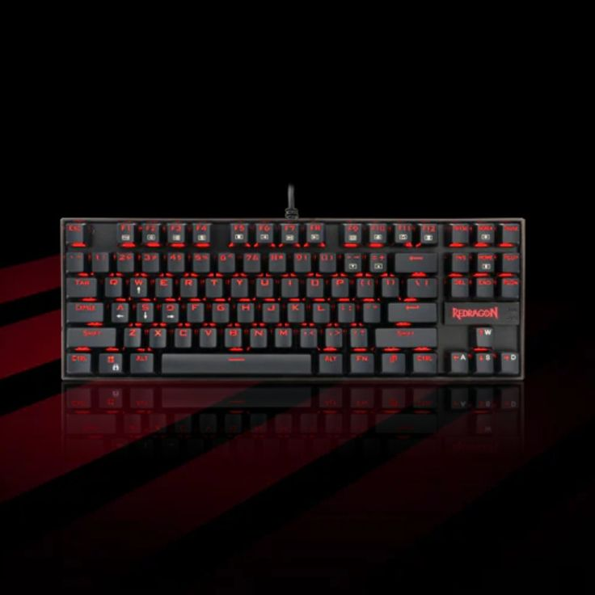

# 🎮 GearStore — E-Commerce de Periféricos & UI Component Library


Plataforma de comercio electrónico de hardware y periféricos gaming/workstation desarrollada con **React 19** y **Vite**. El proyecto destaca por la construcción y utilización de un **sistema propio de componentes UI reutilizables y modulares**, priorizando el rendimiento, la accesibilidad visual y una experiencia de usuario (UI/UX) reactiva y fluida.

---

## 📸 Vista Previa del Sistema

<div align="center">
  
</div>

<br/>

<div align="center">
  
  
</div>

---

## ✨ Características Principales

* **Librería de Componentes UI Propios:** Diseñados desde cero con estilos desacoplados y control de estados en React:
  * 📑 **Tabs & Filtros Dinámicos:** Navegación por categorías de producto sin recargar la página.
  * 🎛️ **Controles Interactivos:** Switch toggles, select dinámico, stepper numérico para cantidades y date ranges.
  * 🖼️ **Showcase & Carruseles:** Visualización interactiva de periféricos con galerías responsivas.
  * 💬 **Feedback al Usuario:** Modales informativos, tooltips de ayuda y notificaciones Toast no bloqueantes.
  * 📊 **Tablas de Comparación:** Componente de tabla con estilos adaptativos para especificaciones técnicas.
* **Enrutamiento Dinámico:** Gestión de navegación y rutas fluidas mediante `react-router-dom` v7.
* **Arquitectura Basada en Componentes:** Código altamente modular, legible y escalable.

---

## 📁 Estructura del Proyecto

```text
tienda-perifericos/
├── public/
├── src/
│   ├── assets/              # Imágenes de periféricos y recursos estáticos
│   ├── components/          # Librería de componentes UI reutilizables
│   │   ├── acordeon/
│   │   ├── boton/
│   │   ├── carrusel/
│   │   ├── modal/
│   │   ├── select-dinamico/
│   │   ├── ShowcaseBox/
│   │   ├── Side-bar/
│   │   ├── stepper/
│   │   ├── switch-toggle/
│   │   ├── table/
│   │   ├── tabs/
│   │   ├── toast/
│   │   └── tooltip/
│   ├── App.jsx              # Estructura principal y layouts
│   ├── main.jsx             # Punto de entrada de la aplicación
│   └── store-theme.css      # Sistema de diseño y variables globales
├── package.json
└── vite.config.js
```

---

## 🚀 Instalación y Puesta en Marcha

1. **Clonar el repositorio:**
   ```bash
   git clone https://github.com/ejcb11/tienda-perifericos.git
   cd tienda-perifericos
   ```

2. **Instalar dependencias:**
   ```bash
   npm install
   ```

3. **Iniciar servidor de desarrollo:**
   ```bash
   npm run dev
   ```

4. **Compilar para producción:**
   ```bash
   npm run build
   ```

---

## 👨‍💻 Autor

Desarrollado por **Eduardo José Contreras Borrero**  
* **LinkedIn:** [linkedin.com/in/eduardo-contreras-dev](https://www.linkedin.com/in/eduardo-contreras-dev/)  
* **GitHub:** [@ejcb11](https://github.com/ejcb11)  
* **Correo:** [ejcb2006@gmail.com](mailto:ejcb2006@gmail.com)
