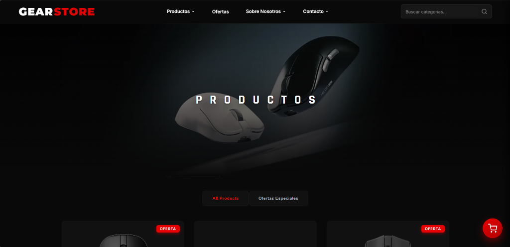
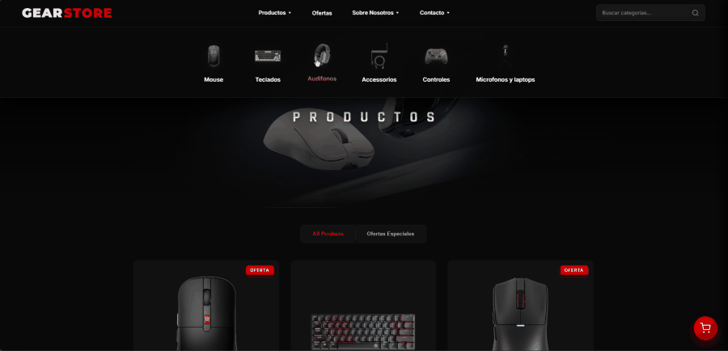
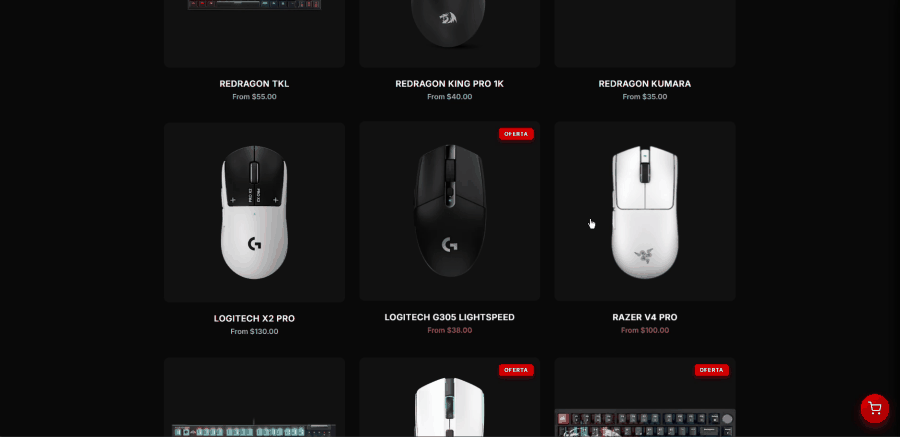
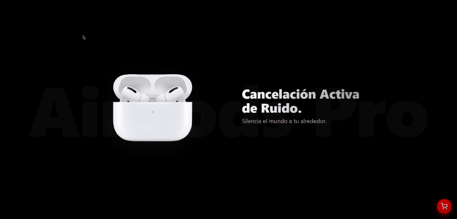
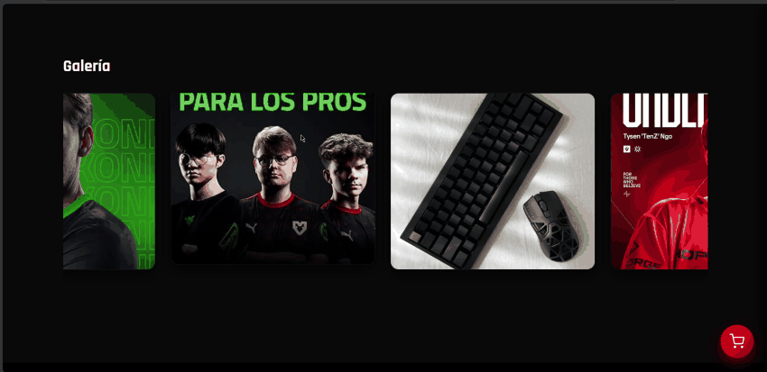
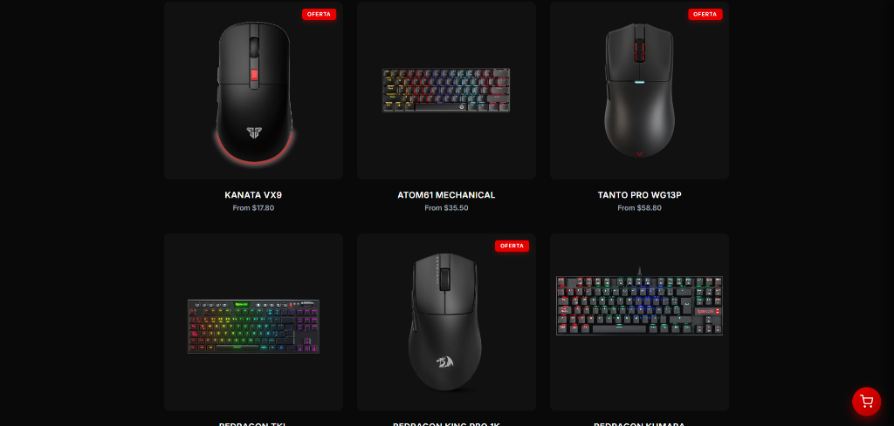
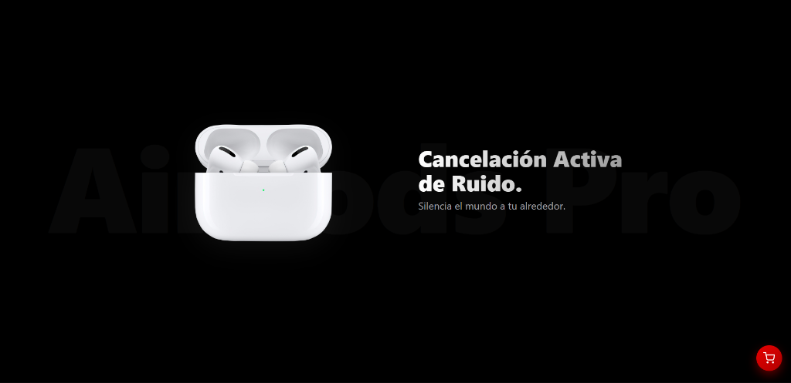
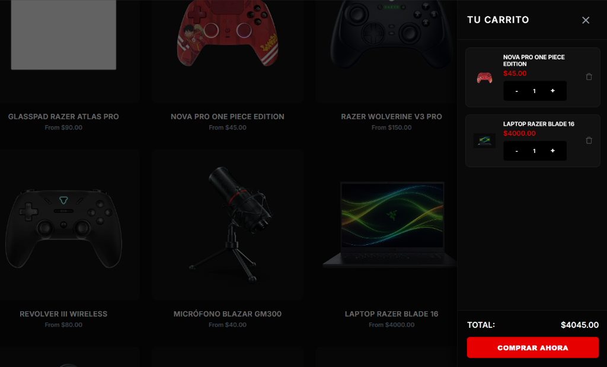
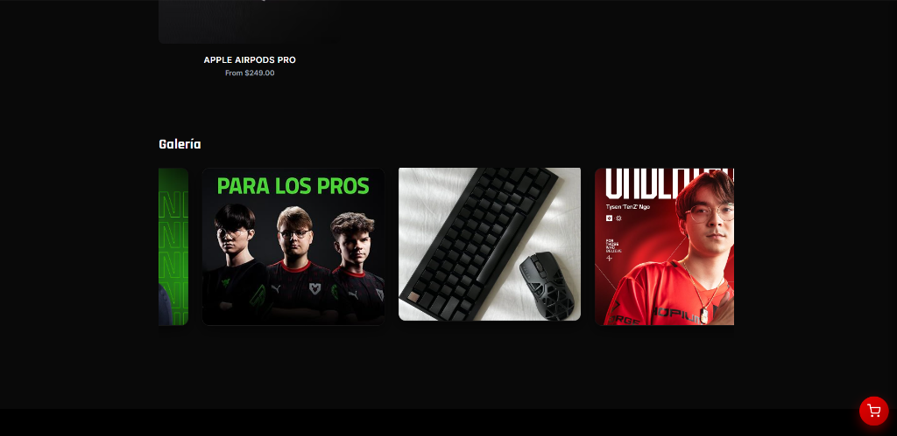

<div align="center">
  
</div>

<h1 align="center">GearStore</h1>
<p align="center">
  Plataforma de comercio electrónico de hardware gaming y librería de componentes UI interactiva.
</p>

<p align="center">
  
  
  
  
  
</p>

---

## Descripcion General

**GearStore** es una tienda web especializada en periféricos de alto rendimiento y hardware gaming construida con **React 19** y **Vite**. 

El núcleo del proyecto reside en el desarrollo de un **sistema propio de componentes UI desacoplados y reutilizables**, integrando control de estados reactivo, animaciones vinculadas a la barra de desplazamiento (Scroll-Driven), carrusel horizontal con arrastre, modales con efecto glassmorphism y un flujo de compra completo con panel deslizable de carrito (Drawer Cart).

---

## Demostraciones del Sistema

### 1. Navegacion, Categorias y Catalogo

<div align="center">
  
</div>

<br />

### 2. Flujo de Compra y Carrito Deslizable

<div align="center">
  
</div>

<br />

### 3. Animacion Interactiva Vinculada al Scroll (Scrollbar Driven)

<div align="center">
  
</div>

<br />

### 4. Carrusel Horizontal con Desplazamiento por Scroll

<div align="center">
  
</div>

---

## Modulos y Funcionalidades

### 1. Catalogo de Periféricos y Filtros Dinamicos

El catálogo clasifica dispositivos por categorías principales (Mouses, Teclados, Audífonos, Accesorios, Controles, Laptops) con renderizado condicional inmediato.

<div align="center">
  
</div>

* **Etiquetado de Ofertas:** Insignias de descuento y precios calculados en tiempo real.
* **Búsqueda Instantánea:** Entrada con filtrado predictivo por nombre de producto y categoría técnica.
* **Filtros Especiales:** Vista directa para productos destacados y promociones exclusivas.

<br />

### 2. Showcase de Hardware Vinculado al Scroll

Sección interactiva inspirada en landing pages de hardware de gama alta. La animación de despiece (Explode View) se sincroniza directamente con la posición de la barra de desplazamiento.

<div align="center">
  
</div>

* **Sincronizacion de Scroll:** Conforme el usuario se desplaza verticalmente, el audífono emerge del estuche y revela sus componentes internos (driver acústico, almohadilla de silicona y procesador H2).
* **Audio Computacional:** Explicación técnica de la cancelación activa de ruido y el rendimiento de baja latencia.
* **Llamado a la Accion Directo:** Botón de compra rápida que despliega el modal de configuración de producto.

<br />

### 3. Gestion de Carrito y Checkout

Módulo de carrito persistente en estado lateral (Drawer) que permite gestionar múltiples artículos en sesión.

<div align="center">
  
</div>

* **Controles Numéricos (Stepper):** Aumento y reducción de cantidades por ítem con validación de mínimos.
* **Cálculo Automático:** Actualización del importe total en dólares (USD) según modificaciones en tiempo real.
* **Acceso Rápido:** Indicador flotante con contador dinámico de artículos acumulados.

<br />

### 4. Galeria de Marca y Carrusel de Comunidad Esports

Carrusel horizontal continuo diseñado para explorar la comunidad competitiva, jugadores profesionales (TenZ, Faker, NiKo) y setups de periféricos.

<div align="center">
  
</div>

* **Desplazamiento Horizontal Fluido:** Navegación optimizada mediante scroll horizontal o arrastre táctil en dispositivos móviles.
* **Respaldado Pro:** Tarjetas visuales de atletas de esports con su equipamiento oficial de torneo.

---

## Librería de Componentes UI Propios

El proyecto se estructuró a partir de una suite de componentes personalizados ubicados en `src/components/`, exportados centralizadamente a través de `src/index.jsx`:

| Componente | Rol en el Sistema |
| :--- | :--- |
| **Modal / AlertModal** | Diálogos modales con backdrop blur (glassmorphism) para avisos y vista previa detallada de producto con selección de color. |
| **SideBar (Drawer)** | Panel lateral deslizable para el carrito de compras con control de backdrop y cierre por teclado (`Esc`). |
| **Stepper** | Selector numérico reactivo para control de cantidades en el carrito. |
| **SwitchToggle** | Alternador de estado para filtros binarios y visualización de ofertas. |
| **Tabs** | Pestañas de conmutación rápida entre categorías de producto sin recarga de página. |
| **Carrusel (Scroll)** | Visor horizontal de galería con navegación continua por scroll y soporte táctil. |
| **ShowcaseBox** | Contenedor interactivo para exhibición de hardware con variantes de color y animación vinculada al scroll. |
| **Toast & Tooltip** | Notificaciones flotantes y microtextos de ayuda contextual. |

---

## Estructura del Repositorio

```text
├── docs/
│   └── screenshots/         # Capturas de pantalla en alta resolución y demostraciones animadas
├── public/                  # Recursos estáticos de la aplicación
├── src/
│   ├── assets/              # Fotografías de productos y periféricos
│   ├── components/          # Librería de componentes UI reutilizables
│   │   ├── acordeon/
│   │   ├── boton/
│   │   ├── carrusel/
│   │   ├── modal/
│   │   ├── select-dinamico/
│   │   ├── ShowcaseBox/
│   │   ├── Side-bar/
│   │   ├── stepper/
│   │   ├── switch-toggle/
│   │   ├── table/
│   │   ├── tabs/
│   │   ├── toast/
│   │   └── tooltip/
│   ├── App.jsx              # Estructura principal, estado del carrito y vistas
│   ├── index.jsx            # Punto de exportación de componentes UI
│   ├── main.jsx             # Renderizado raíz de React 19
│   └── store-theme.css      # Variables de diseño y tema oscuro
├── index.html               # Plantilla HTML base
├── package.json             # Dependencias del proyecto
└── vite.config.js           # Configuración de compilación con Vite
```

---

## Alcance del Proyecto

Este repositorio forma parte de mi **portafolio profesional de desarrollo de software**, concebido para exhibir el diseño de librerías de componentes UI en **React 19**, la gestión de estados globales y la construcción de interfaces interactivas con animaciones sincronizadas al scroll orientadas al sector gaming.

El código y material multimedia se presentan exclusivamente como muestra técnica de competencias Frontend y Full Stack.

---

## Autor

**Eduardo José Contreras Borrero**  
Software Developer & Full Stack Junior  
* **LinkedIn:** [linkedin.com/in/eduardo-contreras-dev](https://www.linkedin.com/in/eduardo-contreras-dev/)  
* **GitHub:** [@ejcb11](https://github.com/ejcb11)  
* **Contacto:** ejcb2006@gmail.com
